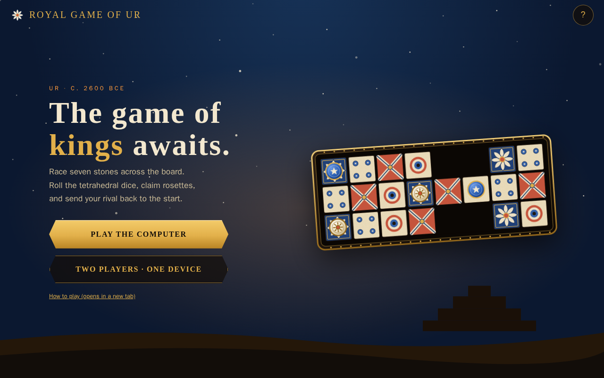
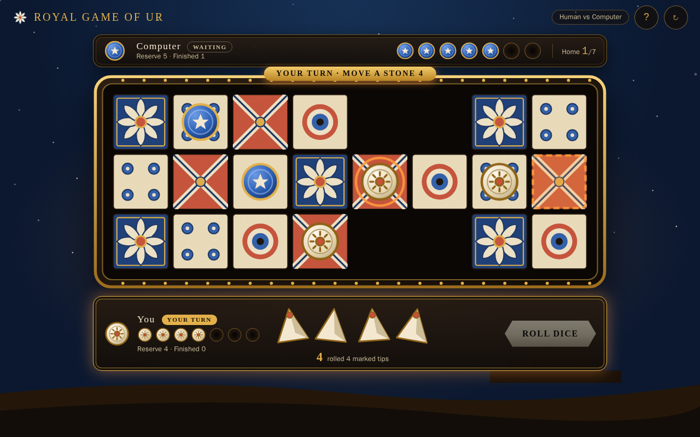
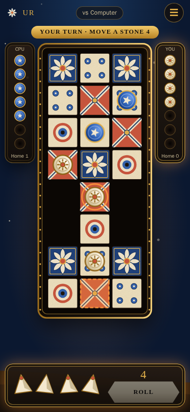

# Art direction (v1)

Drafted by Elin (UX), approved by the owner on 2026-11-20. Every UI change follows it; a new look goes through a new art direction, not through small style stories.

Brief: The current game still does not look good enough. The owner wants a major improvement to UX and visual identity, not another small polish pass. The website feels like an old website; buttons, boxes, Player panels, and the whole interface feel visually bad and boring. Rethink the whole UI/UX with the user at the center, so it does not feel like boring boxes and buttons.

Desired direction: very high-quality, modern gamer-friendly UI/UX that transports the player to ancient times. The Royal Game of Ur board should look much more similar to the original historical board—almost like a photocopy/reference-faithful illustrated version—but implemented with project-owned design/assets and legally safe source/reference handling. The board should be the visual centerpiece. The page, controls, dice, player areas, stones, background, and feedback should feel cohesive, premium, creative, and exciting rather than old-school/basic.

The UX designer should propose mock-ups for the main gameplay screen at desktop and narrow/mobile widths, including board treatment, dice placement, player stone reserves, HUD/player panels, buttons/actions, turn feedback, and page background/atmosphere. Prioritize a single-screen gameplay loop with minimal scrolling where possible.

Owner's note: looks good. make sure to tell developer to add gamified animations to make the game more addective and intresting

## Mood
"Lamp-lit museum vitrine at night in Ur." The British Museum's inlaid board (shell, red limestone, lapis on dark bitumen) is the hero, set in a starry Mesopotamian night with a ziggurat silhouette and warm ember glow. Premium and game-like (think a modern board-game app), not a web form. Board art is project-owned SVG drawn from the public-domain *idea* of the historical layout (3x8, rosettes, eyes, 4-dot, cross tiles); no photos or museum images are copied.

## Palette (tokens)
`--bitumen` #120d09 · `--bitumen-2` #1e150e · `--night` #0b1830 · `--night-2` #173358 · `--lapis` #2a5db0 · `--lapis-deep` #143266 · `--carnelian` #c9503a · `--shell` #f3e8cf (text) · `--shell-dim` #cdbd98 (secondary text) · `--gold` #e2b04a · `--gold-deep` #8f6317 · `--ember` #ff9a3c (legal-move/active glow). Contrast: shell on bitumen ≈15:1, shell-dim on bitumen ≈10:1, gold on bitumen ≈9:1, bitumen on gold (buttons/badges) ≈9:1 – all AA.

## Typography
Display: Palatino/Georgia (already in the project), uppercase with wide tracking for titles, buttons, turn banner. UI/body: system sans, 16 px base. Large numerals in display face for dice results.

## Shapes and illustration (CSS/SVG only)
Inlaid tiles with grain overlay (SVG feTurbulence), gold-beaded board frame, hex-ended "cartouche" buttons (clip-path), double-line gilded panels with dark glass fill. Stones are tactile discs: **ivory with sun engraving (player one)** and **lapis with star (player two/computer)** – distinguishable without colour. Empty reserve slots are dark sockets. Dice are four shell pyramids with carnelian tips.

## Layout (single screen, no scroll)
- Desktop 1280x800: slim top bar → opponent strip (reserve sockets + home count) → board as the centrepiece (~940 px wide) with a gold "Your turn · move a stone 4" banner on its top rim → your dock (identity, reserve, dice, Roll button). Everything fits in 800 px.
- Phone 390x844: banner → vertical board (rotated 90°) flanked by two slim reserve rails (CPU / YOU) → bottom dock with dice and Roll. Touch targets ≥ 44 px.
- Home: hero headline over the board, two big buttons ("Play the computer", "Two players · one device") = start in one click.

## Motion (150–300 ms, `cubic-bezier(.22,1,.36,1)`)
Legal stones/targets pulse an ember ring; stones slide along the track (250 ms); dice tumble then settle (250 ms); capture = stone shrinks back to its reserve; banner cross-fades on turn change; Roll button glows when it is the active action. **Reduced motion:** no pulsing or sliding – static ember outline and instant state changes; turn is also announced via an `aria-live` text.

## Components
Primary button (gold cartouche), secondary (outlined cartouche), icon buttons (round, labelled), player panel (name, "Your turn"/"Waiting" badge, reserve sockets, finished count), turn banner, dice tray, how-to/restart as icon buttons. Visible 3 px shell focus ring on all controls.

## Do / don't
Do: let the board dominate; use ember only for "you can act here"; keep text on dark surfaces. Don't: use plain boxes with default borders, more than two glows at once, colour as the only player cue, or scroll in the main loop.

## Screens covered
Home, Game (desktop and phone). Win/restart dialogs and how-to reuse the same panel/button styles.

## Mock-ups

- **Home**: [page](art-direction/mockup-home.html) · 
- **Game – desktop**: [page](art-direction/mockup-main.html) · 
- **Game – phone**: [page](art-direction/mockup-main-phone.html) · 
